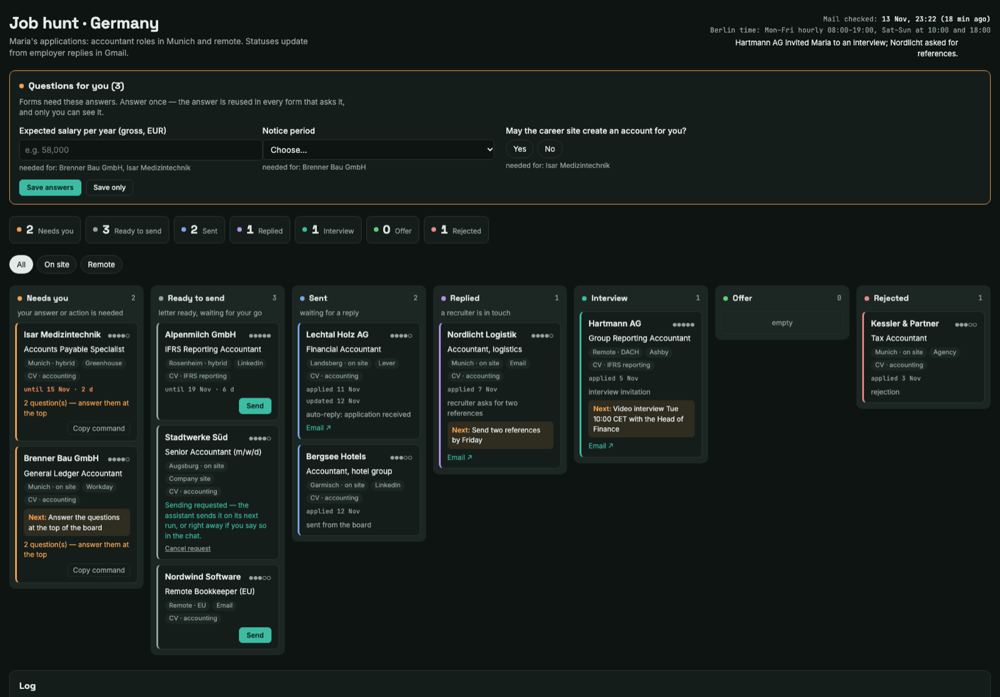

# job-hunt-assistant

A Claude skill that runs a job search end to end, for any profession and any country — builders,
accountants, nurses, chefs, engineers, IT.

**What it does**
1. Asks which country (and work format) the person wants, then their profession and targets.
2. Checks whether a foreigner can do that job there (work permit route, reserved occupations, licences).
3. Interviews them to write an honest CV (HTML → PDF), following that country's CV conventions.
4. Finds live vacancies in parallel (in-country sponsored, remote, niche, agencies) and scores fit.
5. Writes short cover letters (PDF).
6. Creates a live **applications board** (a claude.ai artifact with its own database) — see
   [The applications board](#the-applications-board) below.
7. Sends applications by email (Gmail), company career sites and LinkedIn (Claude in Chrome or the
   app's built-in browser) — only after the person's OK, from the chat or the board's **Send** button.
   Questions a form asks that the profile cannot answer are asked right away, never left waiting.
8. Optionally checks Gmail for employer replies on a schedule in the target country's timezone and
   moves the cards.

Nothing is invented: every fact in the CV, letters and forms comes from the person; unknown answers
(salary, years with a tool) are asked, never guessed. Passwords, verification codes and CAPTCHAs stay
with the person.

## The applications board


*Demo data — fictional candidate and companies.*

The board is a private web page on claude.ai (an Artifact) with its own small database. The page itself never
changes; Claude writes rows into the database and every open copy of the page redraws within seconds — on a
laptop or a phone, in light or dark theme, in the candidate's language.

### What is on it, top to bottom

1. **Header** — the board's name, a one-line description, when Gmail was last checked ("18 min ago"), the
   check schedule in the target country's time, and a one-sentence summary of the last check
   ("Hartmann AG invited Maria to an interview; Nordlicht asked for references").
2. **Questions for you** — every question an application form asked that the assistant could not answer
   from the candidate's profile (expected salary, notice period, years with a tool, "may the site create an
   account?"). Each question appears once, with "needed for: <companies>", as a text field, a drop-down or
   Yes/No buttons. **Save and send (n)** stores the answers and queues every application whose questions are now
   all answered; **Save only** just stores them. Answers are private to the owner and reused in every later form.
   The panel disappears when nothing is open.
3. **Counters** — how many applications are in each column.
4. **Filters** — configurable chips (for example *On site* / *Remote* / *AI roles*).
5. **Seven columns** (each card stays in exactly one):
   | Column | Meaning |
   |---|---|
   | Needs you | blocked on the candidate: an open question, a CAPTCHA, an account, a document |
   | Ready to send | CV and cover letter prepared, waiting for the candidate's go |
   | Sent | submitted; automatic "we received your application" mails keep it here |
   | Replied | a human recruiter wrote back |
   | Interview | an interview is invited or scheduled |
   | Offer | an offer arrived |
   | Rejected | the employer declined |
6. **Log** — the 25 most recent events: what was sent, which replies arrived, what changed.

Inside a column, cards are ordered by deadline (soonest first), then fit, then most recent activity.

### What a card shows

- Company, a **fit score** (●●●●○ = 4 of 5) and the role.
- Tags: location and format, the channel it goes through (LinkedIn, Lever, Ashby, email, company site…),
  which CV variant is used.
- Dates: applied, deadline (orange when 3 days or fewer are left), last update.
- The **last event** ("auto-reply: application received", "recruiter asks for two references").
- **Next** — what the candidate has to do now, highlighted ("Video interview Tue 10:00 CET with the Head of Finance").
- Links to the job posting and to the Gmail thread.
- On *Ready to send* cards, the owner sees a **Send** button.

### The Send button

1. The owner presses **Send**; an inline confirmation says exactly what goes out
   ("CV · IFRS reporting + cover letter, via LinkedIn Easy Apply").
2. **Yes, send** stores a send request in the owner's private part of the database — nobody else can write or
   read it, so a request there is always the owner's own click.
3. The card shows *Sending requested* (with **Cancel request** until it starts), then *Sending now…*.
4. The assistant picks the request up — immediately if the candidate says "send what I requested" in the chat,
   otherwise on the next scheduled check — opens the form in Chrome (with the candidate's logins) or the app's
   built-in browser, attaches the CV and letter, answers from the profile, submits, and moves the card to *Sent*.
5. If the form asks something new, the application stops, the question lands in **Questions for you**, and the
   candidate gets one notification (push, or one email to their own address). After they answer, it is sent.

Before sending, the assistant re-checks that the card is still ready, that it is an application it prepared
itself (the letter and posting match its local files) and that the site does not already show it as applied —
so nothing is sent twice.

### Who sees what

- The board is private until the owner shares it from the page's Share menu.
- People it is shared with see the columns, cards and log, but not the questions panel or Send buttons; they
  get a "Copy command" button that copies a chat command instead.
- Only the owner and editors can change shared rows. Answers (salary and the like) and send requests live only
  in the owner's private subtree, never in shared rows.

### What keeps it current

- **The chat** — every search, letter, submission and answer updates the board right away.
- **Scheduled checks** (optional) — at the times the candidate chose, in the target country's timezone: first
  the send requests and answers from the board, then Gmail. Replies are sorted automatically: auto-reply → stays
  in *Sent*; rejection → *Rejected*; a recruiter's question or request → *Replied* or *Needs you* with the exact
  next step; interview invitation → *Interview* with date, time and format; offer → *Offer*. Cards never move
  backwards. Checks run while the Claude app is open; a missed run catches up on the next launch.

### Under the hood

| Path | What it holds |
|---|---|
| `apps/<id>` | one application: company, role, status, dates, channel, CV, links, next step, open questions |
| `meta/config` | the page's title, language, filters and every label |
| `meta/status` | last check time, schedule, summary |
| `meta/log` | the event log (newest 100) |
| `data/users/<owner>/answers` | the owner's answers to form questions (private) |
| `data/users/<owner>/send-<id>` | the owner's send requests and their state (private) |

The page is `assets/board.html`; the data model is documented in `references/board.md`.

## Install

- **Claude Code / Claude desktop app**: copy this folder to `~/.claude/skills/job-hunt-assistant/`.
- **claude.ai**: download `job-hunt-assistant.skill` from the Releases page and add it under
  Settings → Capabilities → Skills (or open the file and press **Save skill**).

Works best with: Artifacts (for the board), the Gmail connector, Claude in Chrome, subagents and
scheduled tasks. Each is optional — the skill falls back to a local board, prepared emails, links to
open by hand, sequential research and on-demand checks.

## Use

Just say what you want, in any language:
- «Хочу работать бухгалтером в Германии, помоги с резюме и разошли его»
- "Find me site-foreman jobs in Dubai and apply for me"
- «Строитель, ищу работу в Польше с проживанием»

Then drive it from the chat: «отправь все готовые», «найди ещё вакансии», «проверь ответы»,
«что у меня на доске?», «подготовь меня к интервью с X».

## Files

```
SKILL.md                     the workflow
references/cv-interview.md   interview questions by profession, country CV conventions, writing rules
references/job-search.md     work-right checks, where to look, research brief for subagents
references/board.md          board data model, Send button, config in the person's language
references/sending.md        consent rules, channels (email, ATS forms, LinkedIn), send requests
references/monitoring.md     scheduled reply checks, timezone conversion, task prompt template
assets/board.html            the board page (artifact)
docs/board.png               screenshot of the board with demo data
assets/cv_template.html      CV template
scripts/html_to_pdf.py       HTML → PDF with headless Chrome
scripts/make_letters.py      cover letters JSON → PDFs
```

---

## По-русски

Скилл для Claude, который ведёт поиск работы целиком: спрашивает страну и формат работы, профессию,
проводит интервью и пишет честное резюме, ищет живые вакансии, пишет короткие cover letters, создаёт
доску заявок с кнопкой «Отправить» и рассылает резюме только с вашего согласия — через Gmail, сайты
компаний и LinkedIn (Chrome или встроенный браузер приложения). По желанию проверяет ответы
работодателей в почте по расписанию в часовом поясе страны поиска.

### Доска заявок

Это приватная страница на claude.ai со своей маленькой базой данных. Сама страница не меняется: Claude
записывает строки в базу, и все открытые копии доски обновляются за секунды — на ноутбуке и телефоне, в светлой
и тёмной теме, на языке кандидата.

**Сверху вниз:**
1. **Шапка** — название, описание, когда последний раз проверялась почта, расписание проверок по времени страны
   поиска и итог последней проверки одной фразой.
2. **«Вопросы к тебе»** — все вопросы из анкет, на которые ассистент не нашёл ответа в профиле (ожидаемая
   зарплата, срок выхода, годы опыта с инструментом, «можно ли сайту создать аккаунт»). Каждый вопрос показан один
   раз с пометкой «нужно для: …» — полем, списком или кнопками Да/Нет. **«Сохранить и отправить (n)»** сохраняет
   ответы и ставит в очередь все заявки, где вопросов больше не осталось; **«Только сохранить»** — просто
   сохраняет. Ответы видит только владелец, и они подставляются во все следующие анкеты. Когда вопросов нет,
   панель исчезает.
3. **Счётчики** по колонкам и **фильтры** (например, «Офис» / «Удалёнка» / «ИИ-роли»).
4. **Семь колонок:** *Ждёт тебя* (нужен ответ, капча, аккаунт, документ) · *Готово к отправке* (CV и письмо
   готовы, ждут команды) · *Отправлено* (автоответы «заявка получена» оставляют здесь) · *Ответили* (написал живой
   рекрутер) · *Интервью* · *Оффер* · *Отказ*.
5. **Журнал** — 25 последних событий.

**Карточка:** компания, оценка соответствия (●●●●○), должность; метки — город и формат, канал подачи, какое CV;
даты — подано, дедлайн (оранжевый, если осталось ≤ 3 дней), обновлено; последнее событие; **«Дальше:»** — что
сделать сейчас; ссылки на вакансию и на письмо в Gmail.

**Кнопка «Отправить»** (только у владельца, на карточках «Готово к отправке»): подтверждение показывает, что
именно уйдёт → запрос попадает в личный раздел владельца (его никто другой не может ни записать, ни прочитать) →
на карточке «Отправка запрошена» (можно отменить) → «Отправляю…» → ассистент отправляет сразу, если сказать в чате
«отправь запрошенные», или в ближайшую плановую проверку: открывает форму в Chrome (с вашими входами) или во
встроенном браузере, прикладывает CV и письмо, отвечает из профиля и переносит карточку в «Отправлено». Если
анкета спросит что-то новое — заявка останавливается, вопрос появляется в «Вопросах к тебе», и приходит одно
уведомление (пуш или одно письмо на ваш же адрес). Перед отправкой ассистент проверяет, что заявка всё ещё
готова, что это именно подготовленная им заявка и что сайт не показывает её уже отправленной — дважды ничего не
уходит.

**Кто что видит:** доска приватна, пока владелец не поделится ею через Share. Тем, с кем поделились, видны
колонки, карточки и журнал, но не панель вопросов и не кнопки «Отправить» (вместо них — «Скопировать команду»
для чата). Ответы (зарплата и т. п.) и запросы на отправку хранятся только в личном разделе владельца.

**Что её обновляет:** чат — сразу после каждого поиска, письма, отправки и ответа; плановые проверки (по желанию)
— в выбранные часы по времени страны поиска: сначала запросы и ответы с доски, потом Gmail. Ответы сортируются
сами: автоответ → «Отправлено», отказ → «Отказ», вопрос рекрутера → «Ответили» или «Ждёт тебя» с точным
следующим шагом, приглашение → «Интервью» с датой, временем и форматом, оффер → «Оффер». Назад карточки не
двигаются. Проверки идут, пока открыто приложение Claude; пропущенная догоняется при следующем запуске.

### Установка

Скопируйте папку в `~/.claude/skills/job-hunt-assistant/` (Claude Code и десктоп-приложение)
или загрузите `job-hunt-assistant.skill` в claude.ai (Настройки → Возможности → Навыки).
